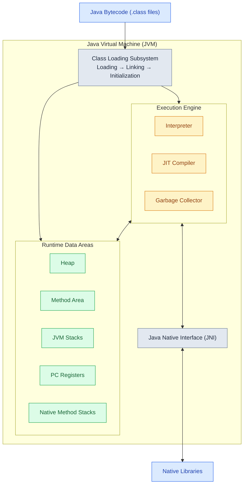

Once during the interview, I was asked about JVM. Frankly speaking, my answer was far from the comprehensive one and I was not happy with it. After the interview I've decided to learn some more about JVM and its components. As a result, I gathered some details about JVM and the answers for the related questions I had during getting familiarized with it. I'm publishing all of them here so that I (or anyone else) could refresh it in the memory anytime.

Of course, the information I can share is not new or unique, it can be easily found by anyone in the Internet. However, I prefer to gather and structure this information in a particular way that helps me to understand things better.

---
# 1. JDK, JRE and JVM

First, let's see how JVM relates to JDK and JRE. The conceptual hierarchy of those in Java 8 can be represented as follows:

```
JDK (Java Development Kit)
  ├── Development Tools (javac, jar, jdb, javadoc)
  └── JRE (Java Runtime Environment)
           ├── Class Libraries (java.lang, java.util, java.io)
           └── JVM (Java Virtual Machine)
                    └── Class Loader, Memory, Execution Engine, Supporting Components
```

**JDK** (Java Development Kit) is a software package that developers use to write, compile, debug, and run Java applications.

**Development Tools** are utility programs used to write, compile, debug, and package Java code. They are bundled inside the JDK.
The core development tools include:
- `javac` (Compiler): translates human-readable source code (*`.java`* files) into platform-independent bytecode (*`.class`* files).
- `java` (Launcher): starts the JRE and launches your compiled Java application.
- `jar` (Archiver): packages multiple .class files, resources, and metadata into a single compressed *`.jar`* (Java Archive) file.
- `jdb` (Debugger): a command-line tool used to find and fix bugs in Java classes.
- `javadoc` (Documentation Generator): automatically creates HTML documentation pages directly from your source code comments (`/** ... */`).

**JRE** (Java Runtime Environment) is a software package that contains everything needed to run a compiled Java program. It consists of:
- JVM: the core engine that executes the code.
- Core Class Libraries: built-in Java packages containing standard APIs that programs rely on to function (e.g., `java.lang`, `java.util`, `java.io`, `java.math`).
- Support files: configuration files, fonts, and property files needed by the runtime environment.

And now, **JVM** (Java Virtual Machine) is a core component of JRE that allows Java programs run on any platform without modification. It acts as interpreter between Java bytecode and the underlying hardware. 

**Important Note:**

Since Java 9, the runtime has been **modularized through Project Jigsaw**. Starting with Java 11, Oracle no longer distributes a separate JRE in the traditional way.
Project Jigsaw restructured how the JDK and Java runtime are organized. 

With Project Jigsaw:
- **JDK**: Still contains development tools, the JVM, and standard Java libraries, but the libraries are organized into modules such as `java.base`, `java.sql`, and `java.logging`.
- **JRE**: Remains a useful conceptual term for the execution environment, but is no longer necessarily distributed as a separate package. The `jlink` tool allows developers to create customized runtime images containing only the required modules.
- **JVM**: Retains its fundamental responsibilities, including class loading, memory management, and bytecode execution, but also supports module-aware loading and access control.

In Java 9+, `javac` supports compiling modular applications, `java` launcher supports module resolution and launching modular applications, `jlink` builds customized runtime from modules. `jdeps` analyzes dependencies between packages and modules. And JVM supports module-aware class loading, access checks, and runtime module representation.

Project Jigsaw is the project that introduced the **Java Platform Module System (JPMS)** in Java 9. 
JPMS is not simply another subsystem inside the JVM, alongside the class loader or execution engine. It spans several layers:
- Compile time: `javac` validates module dependencies and accessibility.
- Runtime startup: The Java launcher resolves modules and constructs the module graph.
- Runtime execution: The JVM enforces relevant module access rules and maintains runtime module information.

The JVM still executes bytecode regardless of whether the application uses JPMS explicitly. 

One more clarification: `java.base` contains fundamental Java APIs such as `java.lang` and `java.util`. The module system does not replace these class libraries; it organizes them into explicitly defined modules.

Importantly, modular application development is optional. Traditional classpath-based applications continue to work with Java 9+.
Therefore, Project Jigsaw did not replace the JDK/JRE/JVM architecture. It introduced modularity across the Java platform, changing how runtime components are organized, dependencies are managed, and applications can be deployed.

**Comparative example:**

Consider a simple application that processes JSON and writes results to a database.

1. Traditional classpath: Application JAR -> Classpath (app classes + dependencies) -> Full Java runtime (standard runtime modules)
2. Modular application: Application module (`module-info.java`) -> Explicit dependencies (requires / exports) -> Custom runtime (optional; selected Java modules)


---
# 2. JVM in Details (more or less)

JVM's main responsibilities are:
- Loading Java bytecode and executing it through interpretation or compilation into native machine code using the JIT compiler.
- Managing memory through heap and stack allocation.
- Performing automatic garbage collection to free up unused objects.
- Ensuring security by verifying bytecode before execution.
- Handling exceptions and runtime errors gracefully.

JVM consists of:

1.  **Class Loader Subsystem** - loads class files into memory.
- *Loads* `.class` files into the memory area
- *Links* (verifies, prepares, resolves) the class data
- *Initializes* classes by executing their static initialization logic when required

2.  **Runtime Data Areas (Memory Areas)** - stores method code, objects, variables, and execution details.
- Heap: stores objects and arrays
- Stack: stores frames for method calls, local variables, and partial results (per thread)
- Method Area (MetaSpace in Java 8+): stores class-level data (metadata, constant pool)
- PC (Program Counter) Registers: hold the address of the next instruction (per thread)
- Native Method Stack: for native methods

3.  **Execution Engine** - converts bytecode into machine code for execution.
- Interpreter: executes bytecode line-by-line
- JIT (Just-In-Time) Compiler: compiles frequently used bytecode into native machine code for speed
- GC (Garbage Collector): automatically reclaims unused memory

4.  **Supporting Components**.
- Java Native Interface (JNI): allows Java code to call and be called by native applications/libraries (written in C, C++ etc.)
- Native Method Libraries: the actual native code (like OS functions) used by JNI



## 2.1. Classloading

In the **LOADING** phase, classloader takes bytecode of a class or interface with particular name and generating the original class or interface from that. Then `.class` file is loaded to the memory area.  Then JVM creates an object from class type for each and every class and puts that object into **heap memory**.

The **constant pool** in Java is a data structure within every compiled `.class` file that stores all constants required by the code (`constant_pool` table). When JVM's class loader reads the `.class` file (which is a binary byte stream), **it parses the data within the constant pool**. The information in the constant pool, which includes class names, field names, and method names represented as strings and other symbolic description, is stored in a structured way in the method area. These textual, symbolic descriptions include **symbolic references**.

There are three built-in class loaders in Java:

1.  **Bootstrap ClassLoader** - root classloader. It loads the standard Java packages such as `java.lang`, `java.net`, `java.util`, `java.io` etc.
    
2.  **Extension ClassLoader** - loads the extensions of standard Java libraries.

**Important note:** 
Since Java 9, the Extension ClassLoader has been replaced by the **Platform ClassLoader**. 
    
3.  **Application ClassLoader** - final classloader (if there's no a Custom one) that loads the files present on the classpath.
    
Additionally, developers can create **Custom ClassLoaders** for specific use cases.  
A custom ClassLoader can be created by extending the `ClassLoader` class and overriding the `findClass()` method. This is useful for dynamic bytecode manipulation, plugin systems, and sandboxing applications.

After the class is loaded into memory, **LINKING** starts. It includes 3 steps:

1.  **Verification**  
    This step is the bytecode verifier of the JVM. During verification, the JVM checks that the class file satisfies structural and type-safety constraints defined by the JVM specification. If verification fails, the JVM may throw a `VerifyError`.
  Note that bytecode verification does not establish that code originates from a trusted compiler or that it cannot perform malicious operations. It verifies structural and type-safety constraints defined by the JVM.
    
2.  **Preparation**  
    In this step, JVM allocates memory for the static fields of a class or interface, and assigns the default values for those fields.
    
3.  **Resolution**  
    In this step, symbolic references (the references inside a compiled `.class` file without embedding direct memory addresses) are replaced with direct references. **I.e. here happens the process of converting symbolic references created during loading into direct, concrete memory addresses or pointers to the runtime constant pool entries.**

And the final stage of that cycle is **INITIALIZATION**, which occurs after loading and the necessary linking steps. However, loading a class does not necessarily trigger its initialization. The JVM initializes a class when it is first actively used, if it has not already been initialized. During initialization, the JVM executes the class initialization method (`<clinit>`), if one exists. This method is generated by the compiler from static field initializers and static initialization blocks.

Active use that triggers initialization includes:

- Creating a new instance of the class using `new`.
- Invoking a `static` method declared by the class.
- Reading or assigning a `static` field declared by the class, except when reading a compile-time constant.
- Certain reflective operations, such as `Class.forName()` with initialization enabled.
- Initializing a subclass, which requires its superclass to be initialized first.
- Starting execution of the designated main class.

Interface initialization follows slightly different rules. An interface is initialized when one of its non-constant `static` fields is accessed or assigned, when one of its `static` methods is invoked, or through certain reflective operations. Initializing a class does not automatically initialize all interfaces it implements, except for superinterfaces that declare default methods.

Unlike classes, initializing an interface does not automatically initialize its parent interfaces.

Note that loading, linking, and initialization are distinct stages. A class can be loaded and linked without being initialized. Initialization occurs before its first active use, according to the JVM initialization rules. Loading makes a class available to the JVM; initialization executes its static initialization logic when required.

### 2.1.1. Delegation model of ClassLoader

**Delegation model** ensures that class loading follows a parent-first approach:

- when a class is requested, the request is *delegated to the parent `ClassLoader`*;
- if the parent cannot find the class, it is *searched by the current `ClassLoader`*;
- this prevents duplicate class definitions and maintains consistency in Java runtime.

It is possible to override delegation model by creating a custom `ClassLoader` and modifying its `loadClass()` method. This is useful for dynamic loading, hot deployment, and certain frameworks like Hibernate and Spring.

### 2.1.2. What if class is not found by any ClassLoader?

In that case, JVM throws:

- `ClassNotFoundException` - occurs when class is not found at runtime using `Class.forName()` or `ClassLoader.loadClass()`; or
- `NoClassDefFoundError` - occurs when a class was available at compile-time but cannot be found at runtime. It can also occur when the JVM previously attempted to initialize a class and initialization failed.

## 2.2. Runtime Data Areas

JVM defines various memory areas to execute Java program. There are used during runtime and are known as runtime data areas. Some of them are created on the JVM start-up and destroyed when the JVM exits, while some are created when a thread is created and destroyed when a thread exits.

### 2.2.1. METHOD AREA

Analogous to storage area for class-level information. The Method Area is a logical JVM runtime data area that stores per-class structures, such as the **runtime constant pool (per-class or per-interface)**, fields and method information, method and constructor code, and class metadata. 

JVM maintains these structures for each loaded class or interface. Their actual physical storage depends on the JVM implementation

***Method area is created when JVM starts up. The memory for this area does not need to be contiguous. All JVM threads share this memory area.***

*Terms note:*

JVM specification defines Method Area as part of the runtime memory. Its purpose is to store:

- class metadata (names, fields, methods)
- runtime constant pools
- method and constructor bytecode
- static field information

The spec does not dictate how this area must be implemented, it only defines behavior. HotSpot (primary, high-performance implementation of the JVM) could implement Method Area differently over time.

*Historically: PermGen (Permanent Generation)*  
Before Java 8, HotSpot used a special memory region called **PermGen (Permanent Generation)** to store class metadata and other class-related structures. PermGen was managed separately from the ordinary Java object heap and had its own memory limits.

If the JVM loaded too many classes or retained excessive class metadata, it could throw `java.lang.OutOfMemoryError: PermGen space`. 

*Modern HotSpot: Metaspace*  
Starting with Java 8, HotSpot removed PermGen and introduced **Metaspace** for storing class metadata. Metaspace provides the primary native-memory storage for class metadata associated with the Method Area, but the two concepts are not identical.

Key characteristics of Metaspace:
- It resides in **native memory**, outside the Java heap.
- It grows dynamically by default, subject to available native memory and JVM configuration.
- Its maximum size can be explicitly limited using `-XX:MaxMetaspaceSize`.
- It stores class metadata, while other class-related structures, such as `java.lang.Class` objects and interned strings, reside in the Java heap.

You can still get `OutOfMemoryError: Metaspace` if class loading is unbounded, but it happens much later because Metaspace is more flexible. Metaspace can be reclaimed when classes are unloaded, which generally requires their defining class loader to become eligible for collection.

Both PermGen and Metaspace serve the same general purpose of storing class metadata in HotSpot, but they use different memory management mechanisms. Neither should be considered a complete, one-to-one physical representation of the Method Area defined by the JVM specification.

### 2.2.2. HEAP AREA

JVM allocates memory for all class instances and arrays from Heap Area.  

Garbage Collection (GC) automatically reclaims heap memory occupied by objects that are no longer reachable. In traditional generational garbage collectors, memory reclamation involves **Minor GC** (collecting the Young Generation) and **Major GC** (collecting the Old Generation). The frequency and sequence of these collections depend on the garbage collector implementation and application memory usage.

As per traditional generational heap organization, Heap Memory has **3 portions**:

- **Eden Space**: part of ***Young Generation*** space. When we create object, JVM allocates memory from this space.
- **Survivor Space**: also part of ***Young Generation*** space. Containts objects which have survived the minor GC phases of GC.
- **Tenured (Old Generation) Space**: Stores long-lived objects. In traditional generational collectors, objects surviving multiple young-generation collections may be promoted to the Old Generation, depending on their age and the garbage collector's policies.

***JVM creates heap area as soon as it start up. All the threads of the JVM share this area. Memory for heap does not need to be contiguous.***

### 2.2.3. STACK AREA

Stores data as frames and each frame stores local variable, partial results and nested method calls.

Each entry in the stack is called **Stack Frame** or **Activation record**.  
Each frame contains 3 parts:

- Local Variable Array - contains all the local variables and parameters of the method.
- Operand Stack - used as a workspace for storing intermediate calculation's result.
- Frame Data - used to store partial results, return values for methods, and reference to the *Exception* table which provides corresponding catch block information in case of exception.

***JVM creates the stack area whenever it creates a new thread. This area is private for each thread. The memory for JVM Stack does not need to be contiguous.***

### 2.2.4. PROGRAM COUNTER (PC) REGISTERS

Each JVM thread has a separate PC Register which stores the address of the currently executing instruction. If the currently executing instruction is a part of the native method then this value is undefined.

PC Register is a small, thread-private memory area that holds the **address of JVM instruction** currently being executed by a thread.

PC Register is one of the few memory areas in JVM that won't throw `OutOfMemoryError`, as it's a fixed size. It's internal JVM mechanism that is not directly accessible for developers via Java code.

**PC Register is not required to be physically contiguous in memory. A new PC Register is created when a new thread is launched in JVM.**  
Its management is handled by the OS and specific JVM implementation.

### 2.2.5. NATIVE METHOD STACK

Native methods are those which are written in languages other than Java. They are declared in Java but implemented in C or C++, to access platform-dependent features or legacy code.

JVM provides capabilities to call these native methods. Native method stacks are also known as "C stacks". They store the native method information. Native methods are typically compiled into platform-specific machine code before execution. During invocation, the JVM may use native method stacks to manage their execution state, depending on the JVM implementation.

**JVM creates these stacks whenever it creates a new thread. So it's thread-private. The memory for native method stack is not required to be contiguous.**

***Summary view:***

```
Process Memory  
   ├── Native memory (OS-managed)    
       ├── Thread stacks  
       ├── Metaspace  
       ├── Direct byte buffers  
       ├── JIT code cache
       └── Internal VM structures  
   ├── Java Heap (GC-managed)   
       ├── Young generation  
       └── Old generation
```

## 2.3. Execution Engine

Execution Engine executes the instructions using information present in the memory areas.  
It has 3 parts:

### 2.3.1. INTERPRETER

Once Classloaders load and verify bytecode, the interpreter executes the bytecode line by line.  
The execution is quite slow. The disadvantage is that when one method is called multiple times, every time new interpretation is required.  
JVM uses JIT Compiler to mitigate this disadvantage.

### 2.3.2. JUST-IN-TIME (JIT) COMPILER

Compiles the bytecode of the often-called methods into native code at run-time. Responsible for optimization of Java programs.

JVM automatically monitors which methods are being executed.  
Once a method becomes eligible for JIT compilation, it is scheduled for compilation into machine code.  
This method is then known as a hot method. This background compilation generally allows application to continue executing while compilation proceeds.

### 2.3.3. GARBAGE COLLECTOR

Garbage Collector is a process of looking at heap memory, identifying which objects are in use and which are not, and finally deleting unused objects.  
Modern GCs use multiple threads for different activities. Depending on the collector, these may include concurrent marking, evacuation, refinement, and stop-the-world operations.
JVM decides when to invoke GC.

## 2.4. Supporting Components

### 2.4.1. JAVA NATIVE INTERFACE (JNI)

It acts as an interface between the Java code and the native (C/C++) libraries.  
There are situations where Java alone doesn't meet the needs for your application. For instance, implementing a platform-dependent feature. In those cases, we can use JNI to enable the code running in JVM. Conversely, it enables native methods to call the code running in the JVM.

### 2.4.2. NATIVE LIBRARIES

These are platform specific libraries. They contain the implementation of native methods.

## 2.5. How JVM Components Work Together

When a Java application starts, the JVM loads, links, and initializes classes as required. The **Execution Engine** executes bytecode using the interpreter and may compile frequently executed code into native machine instructions using the **JIT compiler**.

During execution, the JVM manages memory through its **Runtime Data Areas**, while the **Garbage Collector** reclaims heap memory occupied by unreachable objects. When interaction with native code is required, the JVM can use **JNI** to access platform-specific libraries.

---
# 3. `javac`, interpreter and JIT compiler

`javac` and the JVM **execution engine** solve different problems at different times.

## 3.1. `javac`

Java traditionally uses a two-stage compilation and execution model: source code is first compiled into platform-independent bytecode by `javac`, and the JVM subsequently executes that bytecode using an interpreter and/or a Just-in-Time (JIT) compiler.

Although `javac` performs compilation ahead of execution, this is not what **Ahead-of-Time (AOT) compilation** typically refers to in JVM terminology. AOT compilation generally means compiling Java code into platform-specific native machine code before runtime, rather than relying on JIT compilation during execution.

The initial compilation step produces machine-independent bytecode stored in `.class` files.

At compile time, `javac`:

- Performs syntax and type checking
- Resolves symbols and records them as **symbolic references**
- Emits `.class` files containing bytecode and metadata

`javac` does not know:

- what CPU the program will run on
- which OS it will run on
- which classes will actually be loaded
- which code paths will be hot (frequently executed, performance-critical code segments that should be highly optimized, cached and inlined to minimize latency) or cold (rarely executed and less optimized to save space) at runtime

Therefore, `javac` does not generate native machine code. Instead, it produces platform-independent bytecode that can be executed by compatible JVM implementations on different platforms.

## 3.2. JVM EXECUTION ENGINE

The Execution Engine's job is to **run bytecode**. To do that, it has two main tools:

- **Interpreter**: reads bytecode instructions one by one and executes them.  
    Why it exists:
    - it can start execution immediately
    - it has zero compilation overhead
    - it works even for code that runs only once  
      This is essential for fast startup and short-lived programs.
    
- **JIT compiler**: compiles frequently executed bytecode into native machine code at runtime.  
    Why it exists:
    - it sees real execution behavior
    - it knows which methods are hot, inlined, or rarely used
    - it can optimize using runtime data like branch prediction and actual types  
      The JIT compiler can use runtime profiling information, such as frequently executed code paths and observed object types, to perform optimizations that may not be available to an AOT compiler. However, JIT compilation is not inherently faster than AOT compilation; both approaches have different performance characteristics and trade-offs.

## 3.3. Why both are needed:

If Java relied only on `javac`:
- it would produce bytecode but would still need a runtime capable of executing it. Without a JVM or another execution mechanism, the compiled bytecode could not run.
- we would lose portability
- we would lose runtime optimizations

If Java relies only on JIT:
- startup would be slow
- small programs would pay unnecessary compilation costs

If Java relied only on interpreter:
- long-running code would be far too slow.

So JVM combines all three:
```
Java source  
|  
| javac (build time)  
v  
Bytecode (.class)  
|  
| JVM (runtime)  
v  
Interpreter ---> JIT compiler (for hot code)
```

## 3.4. Deeper design reason

Execution Engine exists because **linking and optimization are intentionally delayed until runtime**. Class loading is lazy, symbolic references are resolved on demand, and multiple class loaders can coexist. That architecture is what enables:

- Dynamic class loading
- Hot code replacement
- Aggressive runtime optimization
- Platform independence

`javac` makes Java portable.  
Execution engine makes Java fast.


#### Some of the sources used:
- https://www.reddit.com/r/java/comments/g8d0cc/jvm_internals/  
- https://www.linkedin.com/pulse/jvm-internals-from-basics-advanced-explained-akshay-kumar-iihje/  
- https://www.baeldung.com/jvm-series  
- https://www.baeldung.com/jvm-vs-jre-vs-jdk
- https://www.geeksforgeeks.org/java/jdk-in-java/
- https://www.ibm.com/think/topics/jvm-vs-jre-vs-jdk_msm_moved 
- https://www.baeldung.com/project-jigsaw-java-modularity
- https://medium.com/javaguides/exploring-modular-programming-in-java-with-project-jigsaw-b33e1d389567
- https://medium.com/@kaustubh.saha/understanding-java-classloaders-24c07542c762
- https://docs.oracle.com/javase/specs/index.html 


```go
package main

import "fmt"

func main() {
    fmt.Println("A new article on Stack Notes!")
}